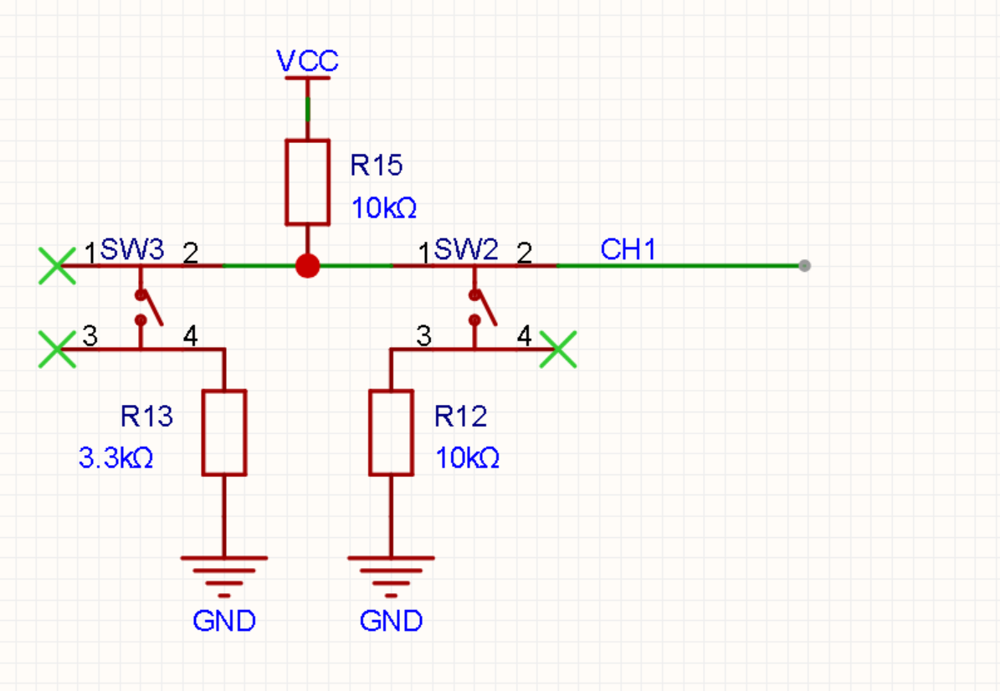

# image1：MCP3202 旋钮与分压按键

2026-10-26起image1使用最新P4扩展板接线，当前配置和操作见 [P4输入说明](image1-p4-inputs.md)。本文旧P3引脚保留为历史记录。

> 2026-10-24 起：image1 使用 `KNOB_DIRECT=0` 关闭了旋钮直连 Canny。
> 上电保持高 25 / 低 8；旋钮只在菜单的 `CANNY`/`CANNY H`/`CANNY L`
> 进入 EDIT 后通过菜单写入调阈值。本文下文“旋钮控制 Canny 阈值”描述的是
> 2026-10-14 的旧行为，image2 仍保留该直连行为。当前菜单操作见
> [image1 屏幕菜单](image1-menu.md)。

本轮在 `images/image1_vision/image1_top.v` 开启 `ENABLE_ADC=1`。
CH0 是旋钮；CH1 是 SW2/SW3 电阻分压按键。原独立 GPIO 按键 B3
继续输出 `key  1`。ADC 在现有 SPI 上通信，OLED 片选保持高电平。

接线图来自用户提供的原理图：

R15 上拉为 10 kΩ；SW2 经 R12=10 kΩ 下拉；SW3 经 R13=3.3 kΩ 下拉。
假设分压 VCC 与 ADC VDD/VREF 来自同一电源，理论 CH1 码值为：
未按 4095、SW2 2048、SW3 1016、两键同时按 814。
尚未实测供电与实际码值，识别窗口可在 `adc_input_ctrl` 参数中校准。

## 驱动与参考

协议参考 [Dominic Meads 的 MCP3202 Verilog 项目](https://github.com/dominic-meads/SPI-master-for-MCP3202-ADC-and-MCP4822-DAC)，
特别是 [V2 源码](https://github.com/dominic-meads/SPI-master-for-MCP3202-ADC-and-MCP4822-DAC/blob/master/ADC/V2.0/SPI_MCP3202.v)
中的单端通道配置与 MSB 优先数据接口。原 V2 的计数基于 125 MHz，通道为编译参数。
本轮按 [Microchip DS21034F 图 6-1](https://ww1.microchip.com/downloads/aemDocuments/documents/APID/ProductDocuments/DataSheets/21034F.pdf)
重新实现适合本工程的整数分频、复位、双通道轮询和数据有效脉冲。

- `src/adc/mcp3202_spi.v`：96 MHz 系统时钟，SPI Mode 0 / 500 kHz。
  CH0 发送 `01 A0 00`，CH1 发送 `01 E0 00`；每次 24 个时钟，接收低 12 位。
  两路交替每 500 μs 启动一次，各 1000 次/秒。MISO 双级同步后在 SCLK 上升沿采样；
  每次转换释放 CS，复位退出后至少等待 1 μs 再拉低 CS。
- `src/adc/adc_input_ctrl.v`：CH0 八点移动平均，收满八点后才输出有效均值。
  CH1 三点中值滤波和区间识别，连续 20 个通道样本稳定后确认按下/松开。
- `src/adc/adc_uart_reporter.v`：16 项按键事件队列，只发送按键消息。
  接入原 UART 仲裁器第四路（image1 不启用 TF 消息），完整一行发完再切换消息源。
  其他镜像 ADC 参数默认关闭；image2 沿用第四路 TF 消息。
- `src/adc/adc_threshold_ctrl.v`：滤波 CH0 映射到 Canny 阈值，带 8 码变化死区。
- `src/vision/edge_threshold_cdc.v`：冻结高/低阈值为一个握手邮箱，接收端在帧边界
  成对应用并确认，发送端再提交最新请求。旋钮持续转动时中间请求合并，不采样跳变中的总线。

## 按键区间与单次触发

窗口：未按 3900～4095、SW2 1900～2200、SW3 940～1100、两键 740～890。
其余值为无效区，会中断稳定计数；无效区不会当作松开。
复位后先要求稳定松开，之后每次有效按下产生一个事件。
长按不重复；按住时从单键变为双键，或者释放其中一个键，也不产生第二个事件。
只有回到未按窗口并稳定确认后，才允许下一次按下。

输出带两个空格和 CR/LF：SW2 `key  2`、SW3 `key  3`、两键 `key  2+3`。
原 GPIO 按键依旧输出 `key  1`。

## 旋钮控制 Canny 阈值

用户选择高低阈值联动：高阈值 = CH0 八点均值 / 2，范围 0～2047；
低阈值 = 高阈值 / 2，范围 0～1023，均向下取整。例如 ADC 2048 对应高/低 1024/512。
均值较上次接管时的 ADC 值变化至少 8 码才更新，减少静止抖动。
均值未准备好时保留默认 45/22；有效后按当前旋钮位置接管。
阈值通过握手跨时钟域，在 RGB 帧同步上升沿成对生效。原其他视频配置更新路径保留。

串口仍为 115200 / 8N1，已移除 ADC 数值定时发送及十进制格式化逻辑。
转动或静止旋钮都不会自动发送 `adc0=... adc1=...`，按键消息照常发送。
H/L、裸数字、加减、R 等原阈值命令继续有效：串口提交时获得控制权，
并以当前旋钮值重新建立死区基准；下一次旋钮移动超出死区再接管。
因此 R 即使 UART 寄存器本来就是默认值，也能恢复实际阈值到 45/22。
串口提交和旋钮变化同时发生时，串口提交优先。本轮不修改黑色识别阈值 B。

## 验证与上板

运行 `tools/test-adc.ps1`。SPI 模型从实际引脚读取命令并根据选中的通道回送数据，
检查命令、24 时钟、交替采样、0/4095/中间码、数据位对齐、MISO 延迟和中途复位。
另有实际 96 MHz / 500 kHz 配置、200 ns ADC 输出延迟的时序仿真。
输入测试覆盖均值启动与滑动、中值毛刺、20 样本消抖、CH0 不推进 CH1 计数、
长按、组合键变化、无效窗口与复位。串口测试解码实际 UART 输出线，检查旋钮
变化无数值输出、事件排队、原 GPIO 按键和命令回复同时到达时的整行连续性。
阈值测试包含上下界与死区、UART H/L/+、UART 默认值未变化时的 R 接管、
异步帧边界成对更新、快速请求合并与复位。原 UART 命令回归也运行。
本次针对改动运行 `tools/test-adc.ps1 -Tests adc_uart_reporter,adc_threshold_ctrl,uart_vision_ctrl`；
SPI 和按键采样逻辑沿用下方已通过的初版验证。

完整编译使用 `tools/build-image.ps1 -Image 1`，须通过实际网表与 Setup/Hold 检查。
阈值控制版下载文件统一为 `images/image1_vision/outflow/Ti60_Image1_Vision_checked.bit`。
2026-10-14 清理时将内容相同的 ADCThreshold 专用文件及旧阶段 bit 归档，
归档位置与保留文件见 [下载文件清单](download-files.md)。
上板使用 E（二值边缘）或 O（彩色边缘叠加）观察旋钮变化，再检查三种按键单次消息。
修改前 ADC 数值显示版源码保存在本地备份提交 `3eeb1ff`；沿用用户已允许的本地备份。
旧 ADC 数值显示版 bit 位于 `outflow/baseline_before_adc_threshold_3eeb1ff/`。
2026-10-14 阈值控制版：静默 UART、旋钮/串口阈值控制与帧边界握手测试、
原 UART 命令回归通过。完整编译、实际控制模块网表检查和全部 28 条
Setup/Hold 约束检查通过，最小余量 +0.020 ns。
系统 Setup +3.324 ns，像素 Setup/Hold +0.203/+0.026 ns，DDR Setup +0.140 ns。
保持 TIMING_2 / seed=7 / effort=2 和原时钟约束；总资源 47,415 XLR / 185 RAM10 / 12 DSP。
阈值选择模块 104 XLR，握手模块 80 XLR；无新增 RAM。尚未上板验证。

阈值控制版长度 2,909,307 字节，SHA256：
`A4E0F2126962D1280EFAFB49EB95FB8FB5FD43912232DF47E958FA291D7E2DF7`。

下方为初版采集驱动的历史验证记录。

2026-10-14 初版：四组仿真均通过。完整编译、实际 ADC/原 GPIO 按键网表检查通过，
全部 28 条约束内 Setup/Hold 非负。保持 TIMING_2 / seed=7 / effort=2 和原时钟约束。
系统 Setup +4.099 ns，像素时钟 Setup/Hold +0.103/+0.029 ns，
DDR core_clk→twd_clk Setup +0.179 ns；最小余量 +0.021 ns。
总资源 47,425 XLR / 185 RAM10 / 12 DSP。三个 ADC 模块合计 899 XLR，无新增 RAM。
此次尚未下载实板；分压键窗口仍需按实际 ADC 读数验证。

初版 `Ti60_Image1_ADC_checked.bit` 长度 2,904,207 字节，SHA256：
`6B4AC722F91B5437DF5B38B153D035B4A563497F5107A568AF0F88DD36C72351`。
