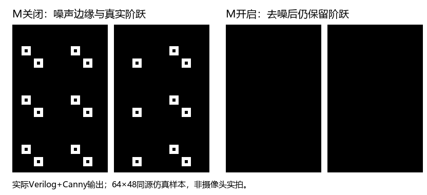

# image1：边缘检测前置 3×3 中值滤波

按本地《易灵思.pdf》赛题四第14页的中值滤波要求，image1 增加正式的
“灰度化→3×3中值→Gaussian→梯度→NMS→双阈值→滞后连接”路径。
此前 `M` 只影响 `G` 灰度显示，Canny仍读原始输入；现在 `M` 也控制边缘检测入口。

## 上板验证

1. 下载本次重新编译、时序检查通过的 `images/image1_vision/outflow/Ti60_Image1_Vision_checked.bit`。
2. UART 使用115200/8N1、ASCII；确认Z测试图与D识别关闭，发送 `E`（回复2）。
3. 固定相机、光照和旋钮，发送 `H60` 回车、`L30` 回车，每条回复K；数值是对照起点，可按场景调整。
4. `F` 返回1，冻结同一幅带细小孤立亮暗点和粗轮廓的画面。
5. 默认中值开启；发送 `M` 返回0关闭，保存边缘画面；再发 `M` 返回1开启，再保存画面。
6. 检查细小孤立噪声边缘减少、主要轮廓仍保留；最后 `F` 返回0恢复实时。
7. 同样检查 `G`、`O` 和 `|` 分屏，以及 `E` 后 `D` 的中文形状识别。
   `|` 左侧始终保留未经中值处理的原始灰度，右侧使用M控制的边缘图。

每条M命令切换状态，不是“设为打开”；以回复0/1为准。现场纸面小点只提供视觉对照，
定量椒盐噪声结论使用下方同源仿真。中值不会消除所有背景轮廓，也可能去掉细小真实细节。
本次没有修改H/L的含义或Canny滞后算法，也没有恢复独立Sobel显示模式。

## 实现与对齐

- `image1_top.v` 开启 `CANNY_MEDIAN_BUILD=1`；此参数在共享平台默认0。
- `image1_median_frontend.v` 使用共享32位两行BRAM窗口，同时处理灰度与RGB，接四组三级精确中值比较网络。
- `G/E` 的上游RGB已复制灰度，因此灰度中值与三路RGB中值完全一致。
  这也保证Canny实际使用的RGB梯度收到过滤后的灰度，避免只改 `per_img_gray` 而噪声仍从RGB入口进入。
- `O` 以及彩色背景上的识别使用对齐后的RGB逐通道中值，保留颜色梯度检测。
  `C` 的普通彩色直通显示仍走原通道。
- 中值开关只切换像素值，VS/HS/DE和未滤波旁路均固定延迟7拍；M请求在共同消隐期更新。显示出口另将六种路径补齐到同一相位，并统一寄存输出。
- 分屏左侧的原始灰度增加中值窗口的中心像素延迟后，再经过现有Canny延迟匹配；不会把滤波后的图伪装成原始图。
- image2使用默认关闭的新增参数；image3～image5有独立平台，未接入本模块。

## 验证命令

```powershell
python tools/check-image1-median.py
powershell -NoProfile -ExecutionPolicy Bypass -File tools/test-image1-median.ps1
powershell -NoProfile -ExecutionPolicy Bypass -File tools/test-image1-median.ps1 -InitialMedian 1
powershell -NoProfile -ExecutionPolicy Bypass -File tools/test-image1-median.ps1 -FullHD
powershell -NoProfile -ExecutionPolicy Bypass -File tools/test-image1-median.ps1 -VideoTiming -FullHD
powershell -NoProfile -ExecutionPolicy Bypass -File tools/test-canny-vision.ps1
powershell -NoProfile -ExecutionPolicy Bypass -File tools/build-image.ps1 -Image 1
```

专用仿真使用真实Canny模块，包含同源脉冲噪声、带噪阶跃和RGB颜色阶跃，
逐像素验证精确过滤结果、M关闭旁路、帧中M请求下一消隐切换、六帧尺寸与完整像素数、
未过滤原始灰度和实际Canny的逐拍/逐像素对齐。64×48测试中：
纯脉冲噪声边缘192→0，带噪阶跃边缘264→96且真实阶跃保留。
1920×1080六帧共12,441,600像素验证通过：纯脉冲噪声边缘129,000→0，
带噪阶跃边缘130,621→2,160，保留真实轮廓。另验证上电默认中值开启的启动与切换。
这些是指定仿真样本的结果，不能外推成实板准确率或所有场景的去噪率。



构建前检查器还验证image1实际顶层端口，防止测试通过但Canny仍接原始RGB。
实际网表检查要求共享中值窗口RAM、原始灰度对齐及固定相位显示出口保留。

## 初版构建记录（已被实板反馈否定）

用户反馈初版下载后各模式花屏、E黑屏；Z正常，M关闭仍异常，前置中值之前的旧版C/E正常。
以下初版虽通过静态时序和算法仿真，不能据此认定上板稳定；同步修复与最新验证见 [显示同步修复](image1-display-fix.md)。

### 初版报告

2026-10-23 23:03（北京时间）使用TIMING_2 / seed=4 / effort=2完成完整编译，
顶层接线、实际网表、构建期间RTL一致性与28项约束内建立/保持关系均通过。
像素时钟Setup/Hold为+0.101/+0.029 ns；DDR `core_clk→twd_clk` Setup为+0.099 ns；
全部关系最小余量+0.018 ns。SDC和外围配置与修改前备份哈希完全一致。

总资源49,552 XLR / 199 RAM10 / 12 DSP。中值前端含2,836.5 XLR / 16 RAM10，
相对原image1总资源增加1,858 XLR和12 RAM10（复用原灰度中值功能）。
原有10项视觉回归、默认中值开/关两种启动，以及1080p六帧端到端仿真均通过。

`images/image1_vision/outflow/Ti60_Image1_Vision_checked.bit`：2,941,314字节，SHA256：
`DDE7CEB009FF931702E0235BE80B2C8FC8E1987A8C6370AAD8385318BD2D66F5`。
同次hex的SHA256：`8BCEA7BD133FF04430C177223107C575216022D5B7524476096A11FF82331FD4`。
image2～image5的bit/hex哈希均未变化。以上是初版软件与实现检查记录；其后用户上板发现异常，因此该初版下载文件已撤换。

## 备份与回退

修改前完整源码（含此前image2未提交工作）已提交并推送GitHub：`11d783d`。
本次修改在独立分支 `codex/image1-median-before-canny-20261023`。

修改前image1的checked.bit、hex、工程配置、外围配置、SDC、时序和网表报告保存在：

`E:/Efinity_Project/bit_hex_archive/Image1_before_median_canny_11d783d_20261023.zip`

旁边 `.manifest.json` 记录长度与SHA256，ZIP内文件已全部核验。
seed=7首轮的DDR `core_clk→twd_clk` Setup为−0.057 ns，未更新checked文件；
失败产物另存 `E:/Efinity_Project/bit_hex_archive/Rejected_Image1_median_seed7_20261023.zip`。
seed=8的同一路径为−0.009 ns，也未作为checked文件交付，另存同目录
`Rejected_Image1_median_seed8_20261023.zip`。各轮均保持原SDC和外围配置。
只回退板上行为时，解压旧 `Ti60_Image1_Vision_checked.bit` 并通过JTAG下载即可。
源码回退可从GitHub备份提交另建目录/工作树，避免覆盖其他正在进行的修改。
本次未执行板上JTAG下载或写Flash。
