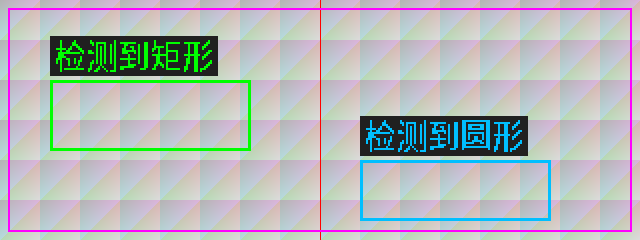

# image1：检测框中文标签

本文保留2026-10-20中文标签版的实现和验证记录。2026-10-23的当前image1已增加
[Canny前置中值](image1-median-canny.md)，保留此中文标签功能；当前下载哈希以
[下载清单](download-files.md)为准，本文末尾10月20日的哈希用于旧版回退追溯。

2026-10-20 增加 HDMI 中文检测结果显示。打开 image1 的形状识别模式（串口
发送 `D`，返回 `1`）后，两个已有检测目标各自显示对应文字：

- `CIRCLE`：青蓝色框与“检测到圆形”。
- `RECT`：绿色框与“检测到矩形”。
- 尚未确认类型：保留已有黄色框，不显示已识别文字。
- 目标失效时，对应文字随该目标有效信号清除。

文字使用 16×16 汉字点阵放大两倍，每字 32×32；五字加四周留白共
168×40 像素，使用深灰色底。通常放在框左上方，与框间隔 4 像素；
靠近画面顶端时移到框顶部内侧，右侧或底部越界时向画面内钳位。
两个标签重合时第一目标优先，与已有检测框的重合优先级一致。

## 实现

`shape_label_overlay.v` 在原 `shape_overlay.v` 输出后增加三拍流水线，
分别完成文字区域/字地址计算、字模行读取和像素选择；RGB 与三个视频
同步信号一起延迟。检测、分类、ROI、ADC 和串口命令保持现有实现。
仅启用形状识别硬件的 image1 综合这条路径；image2/image3 不综合该路径。
image3 独立平台的 include 列表同步补全新共享模块定义，不改变其功能配置。

字模保存在 `shape_chinese_font.v`，无需运行时加载文件。
可用 `python tools/generate-shape-font.py` 从本机 Noto Sans SC 字体重新生成。
构建使用已检入的 Verilog 字模，不依赖系统字体或 Pillow。

## 验证

```powershell
powershell -NoProfile -ExecutionPolicy Bypass -File tools/test-shape-labels.ps1
powershell -NoProfile -ExecutionPolicy Bypass -File tools/test-shape-labels.ps1 -FullHD
powershell -NoProfile -ExecutionPolicy Bypass -File tools/test-canny-vision.ps1 -Tests shape_overlay_tb
powershell -NoProfile -ExecutionPolicy Bypass -File tools/build-image.ps1 -Image 1
```

前两项用 Pillow 独立绘制完整参考帧，与实际 Verilog 输出逐像素比较：
640×240 五帧共 768,000 像素、1920×1080 五帧共 10,368,000 像素均通过。
覆盖两个目标的独立类型、类型互换、顶部/右侧/底部位置、标签重合、
未知分类与目标失效，并逐拍检查行场同步、有效信号和消隐黑色。
原背景、红边、ROI 和检测框颜色回归通过。

实际仿真输出预览：`work_sim/shape_labels_640x240/shape_labels_actual.png`。
下图来自实际 Verilog 输出（测试图，不是实机拍摄）：



新增文字模块综合资源为 385 XLR、2 RAM10、0 DSP；两个字模 ROM 均保留。
构建脚本的实际网表检查新增文字模块和两个字模 ROM 的保留验证。

2026-10-20 22:47（北京时间）完整编译、网表检查及 28 项约束内建立/保持
关系通过。使用原 TIMING_2 / seed=7 / placer_effort_level=2 配方；
像素时钟 Setup/Hold 余量 +0.254/+0.035 ns，全部关系最小余量 +0.011 ns。
整机综合网表为 47,694 XLR / 187 RAM10 / 12 DSP。

下载文件：`images/image1_vision/outflow/Ti60_Image1_Vision_checked.bit`，
长度 2,914,131 字节，SHA256：
`C7FBFA2F41183B16049099287EE7290E9FA6754B511B3D41695DAF9EFF9B3591`。
同次导出 hex 的 SHA256：
`D744A5852848F4BFC169C1FEB1A43917E8BBB988D16D7E3D9B53B53989C83E9C`。
image2/image3 下载文件的长度与 SHA256 均未改变。

## 修改前备份

源码基线 `391d9f6` 已推送到 GitHub。
修改前 image1 的 bit、hex、时序/网表报告及工程配置备份于：

`E:/Efinity_Project/bit_hex_archive/Image1_before_chinese_labels_391d9f6_20261020.zip`

同名 `.manifest.json` 记录长度和 SHA256；ZIP 内各文件均已逐字节哈希核对。
本次未执行板上 JTAG 下载或写入 Flash。
