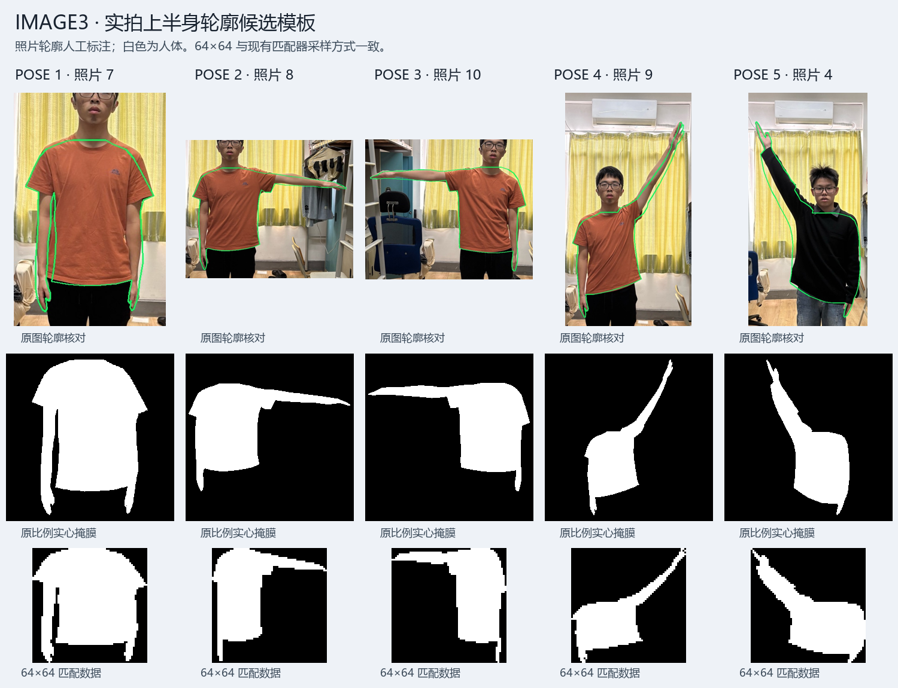

# image3 实拍上半身掩膜模板（V 回复 P）

五类主模板改用用户实拍照片的人工轮廓标注，保留衣服、肩宽、手臂粗细和实际倾斜，
不再由关节点扩成固定粗细的几何人体。源图中的头、颈和腿由人工标注排除。
本轮只替换模板与版本标识，保持白背景/差分分割、Canny 辅助、阈值和串口确认逻辑。

左右按画面定义：POSE1 双臂下垂（照片7）、POSE2 右侧平举（照片8）、
POSE3 左侧平举（照片10）、POSE4 右侧上举（照片9）、POSE5 左侧上举（照片4）。
旧 POSE1 的双臂向外张，现改为照片中的贴身下垂；其他类同时修正非动作手臂和躯干形状。

## 来源和复现

- `samples/pose_photo/pose1.pgm`～`pose5.pgm`：紧框原比例实心掩膜，黑人体、白背景。
- `samples/pose_photo/annotations.json`：原照片 SHA256、人工轮廓坐标、来源编号及限制。
- `samples/pose_photo/validation/`：照片1、2、3、5、6的额外掩膜及标注；2、3、6手部出画，未作为主模板。
- `samples/pose_upper/pose1.pgm`～`pose5.pgm`：当前 C++ 对照测试使用的同一份主模板。
- `src/vision/pose_templates.vh`：4096×10 位 ROM，低5位实心模板、高5位8邻域边界；无运行时文件依赖。
- `docs/pose-template-manifest.json`：本次源掩膜、标注及原照片哈希，归一化前景/边界数量。

运行 `python tools/export-pose-templates.py` 生成，追加 `--check` 只核对。
默认来源为仓库内 `samples/pose_photo`，不再读取 C++ 全身几何样本。
沿用最大8连通区域、紧框、64×64 像素中心整数采样：
`x=xmin+floor((2*i+1)*width/128)`，y同理；横纵分别缩放，与当前 RTL 一致。
原照片 RGB 文件没有加入仓库；标注轮廓仍有人工误差，不是像素级分割真值。

## 上板流程

1. 使用最新 `images/image3_pose/outflow/Ti60_Image3_Pose_checked.bit` 进行 JTAG 下载。
2. 串口 115200 / 8N1，ASCII 文本，关闭 HEX；单独发 `V` 应回复 `P`。
3. 发 `C` 检查实时画面；F 最后回复0，Z最后回复0。
4. 白布测试：上电默认仍为差分，发 `%` 回复1切入白布模式，发 `I` 回复W，发 `Q` 等待1。
   此处 I 的 W 表示白布模式，与 V 的版本 P 含义不同。白布模式不用 b。
   普通静态背景测试：保持差分模式（I回复R），无人时发 b，等待Q回复1，再让人进入。
5. 发 `U3` 看实心人体掩膜：先发大写U再发数字3，或一次发送ASCII字符串U3，无需回车。
   躯干和双臂应完整，背景为黑色。U5检查人体框，U6检查同区域的真实Canny。
6. 依次做五种动作，每种保持2～3秒。连续三个完成快照确认后报告POSE1～5，
   识别期间每0.5秒发送一行；#可主动查询，丢失后POSE0一次。

例如 `POSE:2 SCORE:0722 GAP:0249 E:0450`，数值均为千分制。
SCORE是IoU相似度，不是正确率或概率；GAP是第一、第二名之差。
判定仍需 SCORE>=550、GAP>=80、同快照Canny边界覆盖E>=200及边缘帧有效。
没有为了让新模板通过而下调门限，也未修改Canny默认0/0或打开ADC。

## 验证范围与限制

23组匹配仿真使用原C++ `identify_pose` 作为独立数值对照，核对每类交集、并集、取整分数和最终拒识。
包括五张自模板、空/混合/孔洞/小尺寸/偏移输入、缺边缘/无效边缘及五张额外照片掩膜。
另检查快照冻结、取消、UART三次确认及周期报告、RAW差分与白布路径集成。

额外完整照片1与5的同类IoU由旧模板369/328提高到781/638。
这是人工照片掩膜的离线数值，不是板上识别率；自模板1000分也不代表泛化能力。
离线额外照片使用全有效辅助边缘，仅验证掩膜计算，不能证明实际摄像头Canny一定满足E门限。

模板已人工去头、去腿，FPGA仍不会自动完成这一步。
若U3包含头、腿、严重阴影或漏掉皮肤，与模板范围不同会降低分数。
尤其举臂时不能仅靠水平裁图同时删除头并保留高举的手；应以实际U3范围核对，
必要时再用摄像头截图制作范围一致的模板。本轮未额外加入头部检测或裁剪算法。
手机与板载镜头、衣服、距离和分割效果不同，仍需现场测试。

## 本地备份

修改前提交 `ba042a1`，本地标签 `codex/backup-image3-before-photo-templates-20261021`。
旧image3 bit/hex、报告及模板已归档并核对哈希：
`E:/Efinity_Project/bit_hex_archive/Image3_before_photo_templates_ba042a1_20261021.zip`。
本轮只使用本地备份，不推送GitHub；不执行JTAG下载或Flash写入。

## 2026-10-21 14:33 构建记录

完整编译通过，26,048 / 60,800 XLR、243 / 256 RAM10、34 / 160 DSP。
RAM与DSP占用不变，无需移除Canny或降低差分占用。
28项setup/hold关系全部通过，像素时钟余量+0.886/+0.030 ns，所有关系最小余量+0.019 ns。
实际映射ROM的40,960位INIT、地址、时钟、读延迟和写禁用逐一核对；损坏INIT及缺失ROM反例均拒绝。

23组C++/RTL逐类数值对照、UART、快照及普通RAW集成回归通过；另通过相邻阴影场景和无需背景的白布场景。
快照测试用C++另算输入64×64掩膜收紧后的预期分数，不假设归一化一定占满64行。
POSE2占63行，再收紧后的预期分数为983，测试已核对，未修改硬件归一化行为。
image1、image2、image4、image5的8份bit/hex哈希与修改前一致。

- checked.bit：2,551,479字节，SHA256 `2B7A416D227BA012014F3F40BDC033F6EE8B9BD188756D8A4231BA7E4DF4982F`。
- hex：2,551,539字节，SHA256 `69C4CCA3BD91E01BE04BDDD7789F8A30DD23DF75F0F5259031F0853472431673`。
- 构建记录：`work_sim/image3_photo_build.log`。
- 数值、快照、UART、集成回归：`work_sim/image3_photo_pose.log`。
- 阴影/白布集成：`work_sim/image3_photo_shadow.log`、`work_sim/image3_photo_white.log`。
- 接线反例：`work_sim/image3_photo_wiring.log`。
- 文件、资源及时序记录：`images/image3_pose/outflow/Ti60_Image3_PhotoTemplates_validation.json`。

最终文件见[下载文件清单](download-files.md)。上述验证均为本地仿真/编译；未上板、未写Flash。
