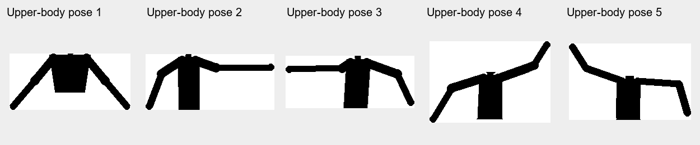

# image3 上半身匹配版（V 回复 U）

当前五类参考使用[实拍上半身轮廓](image3-photo-templates.md)，`V` 回复 `P`；以下为此前版本记录。

当前增加了 [白背景分割模式](image3-white-background.md)，版本查询改为 `V` 回复 `W`，`%` 切换白布/原差分。
原差分的 [光照/阴影抑制](image3-lighting.md)、上半身模板和每 0.5 秒 POSE 输出保留；`~` 只开关原差分的光照处理。以下保留原上半身版的取景和阶段记录。

按用户确认，镜头只拍上半身，不要求头和腿进入画面。
本版将五类参考改为肩部、躯干和双臂，沿用差分掩膜 IoU 与同快照 Canny 辅助确认。
不需要先检测全身再按比例截取；不会在已经只有上半身的输入上再次裁掉一截。

## 取景与使用

1. 下载最新 `images/image3_pose/outflow/Ti60_Image3_Pose_checked.bit`，发送 `V` 必须回复 `U`。
   回复 `9` 仍是旧的全身匹配版；其他旧版本也不适用于本页流程。
2. 镜头拍摄颈部以下到腰部附近，躯干、左右肩膀、双臂和手尽量完整；头和腿不需要出现。
   手低于腰线时仍需保留手；抬臂时也要保留手腕。不要为了裁掉头而把举起的手一起切出画面。
   原五类动作的手臂方向仍保留，腿的位置不再参与分类。
3. 发送 `C` 检查实时画面，F 最终回复 0（解除冻结），Z 最终回复 0（关闭测试图）。
4. 固定机位，无人时发送小写 `b`，等待 `Q` 回复 `1`，再进入画面。
5. 发送 `U3` 查看白色上半身掩膜，`U5` 查看其 ROI，`U6` 查看 ROI 内真实 Canny。
6. 做出模板中的手臂动作，保持约 2～3 秒。
   连续三个完成快照确认后立即输出 `POSE:1`～`POSE:5`，随后约每 0.5 秒自动重复发送当前姿态及最新分数。
   不需要轮询 `#`；`#` 仍可主动查询。新姿态经三次确认后立即报告，再按周期重复。
   识别丢失时自动发送一次 `POSE:0` 并停止循环发送，重新识别成功后恢复。

输出仍为 `POSE:3 SCORE:0720 GAP:0120 E:0450`，SCORE/GAP/E 都是千分制。
定时由 96 MHz 系统时钟计数，`person_pose_uart` 的 CLOCK_HZ=96000000、REPORT_HZ=2。
分数更新不会重新计时；每行开始时锁定最新稳定结果，已开始的行发送完整后才切换。
UART 忙碌时合并为一个待发请求，不排队保存每次到期的旧结果。
手动查询会立即请求一行，并从该行开始重新计算自动报告间隔。
判据仍为 IoU >=550、领先第二名 >=80、边缘支持 >=200，且边缘帧有效。
这些为原型初值，真实上半身、衣服和视角差异仍需要实拍验证与校准。
画面没有增加姿态编号或骨架，当前匹配结果看串口。
输入若包含大量头、腿或截断的手臂，结果不保证；本版采用用户选定的上半身取景方式，并非全身自动去头去腿。

## 模板与验证方法

`tools/export-pose-templates.py` 从原 C++ 的五张 PGM 和 `pose_template` Q0.8 关节几何派生新参考。
保留肩部至骨盆的躯干带，以及四段手臂的原始前景像素；删除头和腿。
手臂保留区域允许高于肩膀、低于腰线，避免矩形裁剪删除手腕。
派生数据仍使用 8 连通最大区域和 C++ 原来的紧框/64×64 像素中心采样。
脚本检查头/脚踝中心已删除，双肩、双肘、双手腕仍保留。

五份派生参考保存于 `samples/pose_upper/pose1.pgm`～`pose5.pgm`，
`docs/pose-template-manifest.json` 保存原 PGM、C++ 源文件及派生 PGM 哈希、关节几何、裁剪范围。
Verilog ROM 在构建前生成，不在 FPGA 上额外运行裁剪或读取图片文件。
原 C++ 工程没有修改；测试直接编译原 `identify_pose`，使用这五份派生参考作为模板目录，
对照 RTL 的五路交并集、取整分数、排名、拒识和上半身端到端差分结果。

本版保持原差分、Canny、UART、三快照确认、ADC 关闭及 0/0 默认阈值。
仅替换参考数据和版本标识，没有新增完整帧缓存，也没有将 Canny 降级为 Sobel。

2026-10-20 21:34 的完整构建和实际网表检查通过，资源保持 23,012 XLR / 241 RAM10 / 20 DSP。
全部 28 项列出的 setup/hold 通过，最小余量 +0.018 ns，像素 setup/hold +0.905/+0.035 ns。
18 组上半身数据的五路分数与原 C++ 匹配函数一致，四项姿态仿真全部通过；
映射后 ROM 全部 40960 位 INIT 逐一核对，损坏位和缺失 ROM 的反例均被拒绝。
五张上半身自模板得到 1000 分，领先第二名 657/765/657/677/677；这仅验证模板区分和移植一致性，不能作为实拍准确率。
image1/image2 的四份保留 bit/hex 哈希未变；工程仍保留六份 bit/hex。

当前 checked.bit 为 2,494,041 字节，SHA256：
`17F089336157F58305FFF47D670A03A4A34023D7AB618BF6AE94FE670457332F`。
同次 hex 为 2,494,101 字节，SHA256：
`B1AEEB19EAC2D1E356CB2C57CA5BDD8B174984C717211F1EFD73A20476BF2654`。

以上 21:34 哈希是修改定时报告前的上半身版阶段记录，当前文件以下载清单及下方新构建记录为准。

## 本地备份与板上状态

修改前源码为 `c598088`，本地备份标签为 `codex/backup-image3-before-upper-body-20261020`。
旧 V9 全身版 bit/hex 与报告已归档，并逐一核对原文件哈希：
`E:/Efinity_Project/bit_hex_archive/Image3_full_body_c598088_20261020.zip`。
按用户要求仅本地保存，不执行本轮 GitHub 推送。本次没有 JTAG 下载或 Flash 写入。

## 成功识别后的周期串口报告

按用户要求，将原“姿态变化时发送”改为“成功识别期间持续定时发送”，保持三快照确认和原文本格式。
UART 回归覆盖：首次三次确认、正常重复间隔、最新分数、手动查询、姿态切换、识别丢失停止、
UART 长时间阻塞时待发请求合并，以及未知结果不周期刷屏。
本轮修改前源码为本地提交 `947975e`，标签 `codex/backup-image3-before-pose-repeat-20261020`。
旧 bit/hex 和报告已归档并校验到：
`E:/Efinity_Project/bit_hex_archive/Image3_upper_change_only_947975e_20261020.zip`。

2026-10-20 21:42 定时报告版完整编译、实际网表与全部 28 项 setup/hold 检查通过。
最终资源 23,011 XLR / 241 RAM10 / 20 DSP；最小余量 +0.006 ns，像素 setup/hold +0.914/+0.034 ns。
checked.bit：2,486,421 字节，SHA256 `434A77D2F40AD852B6C77422A02EE0F6C6DDC34C2660028422622290A6B2153C`。
同次 hex：2,486,481 字节，SHA256 `4F1C21D5120F297BED766FF7773CB06469030400DC6ACA28329924F5ACD557CC`。
定时 UART 仿真和顶层接线反例检查通过，image1/image2 保留文件哈希未变，仍为六份 bit/hex。
本次仅本地备份、修改和编译，没有 JTAG 下载或 Flash 写入。
